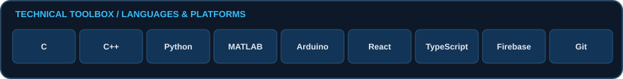
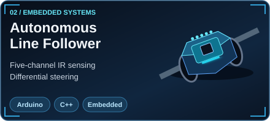
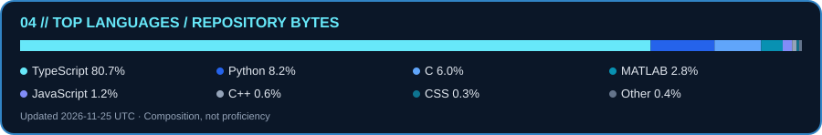
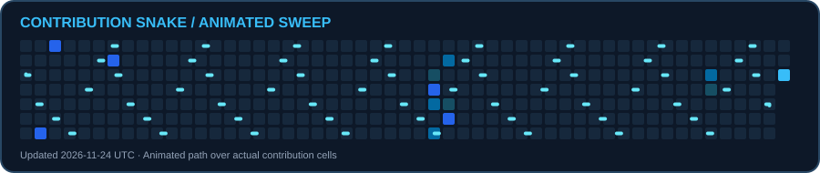

<p align="center"></p>
<p align="center"></p>

<p align="center"><a href="https://linkedin.com/in/idan-vimenetz"></a> <a href="https://github.com/DanoV1m">GitHub</a></p>

## 01 // System overview

```text
danov1m@engineering:~$ whoami
Electrical & Electronics Engineering Student
Ruppin Academic Center
danov1m@engineering:~$ mission
Connecting mathematical models, software and physical hardware.
```

I build educational engineering projects in feedback control, robotics, digital signal and image processing, computer architecture and systems programming. I distinguish simulations and experimental work from physically validated results.

## 02 // Technology stack



<p align="center"></p>

Embedded and digital systems: Arduino, FPGA coursework, digital logic, circuit analysis. Engineering methods: modeling, simulation, debugging, documentation and testing.

## 03 // Featured engineering projects

<p align="center">
<a href="https://github.com/DanoV1m/pid-control-simulator"></a>
<a href="https://github.com/DanoV1m/Arduino-Line-Follower-Robot"></a>
<a href="https://github.com/DanoV1m/SmartPixelProcessor"></a>
<a href="https://github.com/DanoV1m/EasyCharge-System"></a>
</p>

| Project | Engineering focus |
| --- | --- |
| [PID Control Simulator](https://github.com/DanoV1m/pid-control-simulator) · [Documented live demo](https://idan-pid-simulator.streamlit.app/) | LTI feedback, transient and frequency response |
| [Autonomous Line Follower](https://github.com/DanoV1m/Arduino-Line-Follower-Robot) | Sensor-based navigation; experimental PID not physically retested |
| [SmartPixelProcessor](https://github.com/DanoV1m/SmartPixelProcessor) | Intensity transformations and edge detection |
| [EasyCharge System](https://github.com/DanoV1m/EasyCharge-System) | Educational EV charging simulator, not a production service |

Card graphics are illustrations, not measured results or screenshots.

## 04 // Development telemetry




Language bytes are repository composition, not proficiency. Public, owned, non-fork repositories only.

## 05 // 3D contribution map


## 06 // Contribution snake



Calendar graphics use GitHub's contribution aggregate, not private repository names or code. They may reflect aggregate private activity if GitHub exposes it under profile visibility settings.

## 07 // Engineering soundtrack


## Academic background

Electrical Engineering, Ruppin Academic Center. Coursework includes circuit theory, digital systems, computer architecture, differential equations, mathematics and physics.

<details>
<summary>Engineering review branches — proposed upgrades, not releases</summary>

- [Control systems review](https://github.com/DanoV1m/pid-control-simulator/tree/upgrade/engineering-review): root locus, Nyquist and actuator saturation experiments.
- [Embedded robotics review](https://github.com/DanoV1m/Arduino-Line-Follower-Robot/tree/upgrade/engineering-review): optional discrete PID and bench validation protocol.
- [Image processing review](https://github.com/DanoV1m/SmartPixelProcessor/tree/upgrade/engineering-review): spatial filtering, FFT and image similarity metrics.
- [C systems review](https://github.com/DanoV1m/EasyCharge-System/tree/upgrade/engineering-review): ownership fixes, staged persistence and cross-platform checks.

</details>

<p align="center"><strong>DESIGN · BUILD · SIMULATE · VALIDATE</strong></p>
