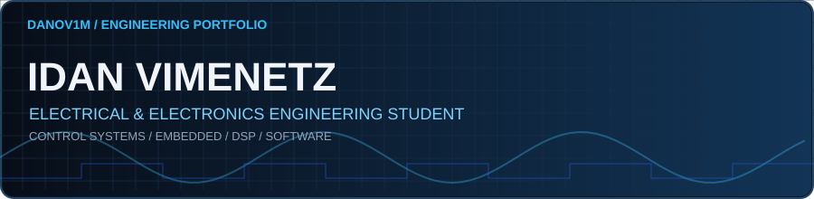
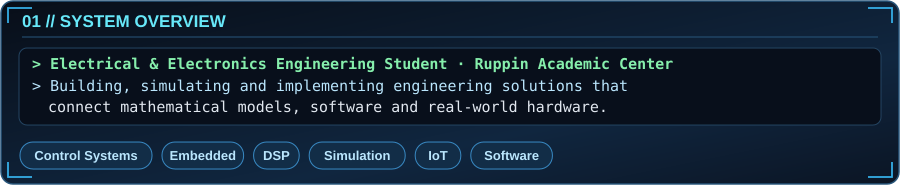
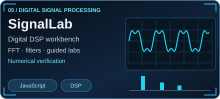
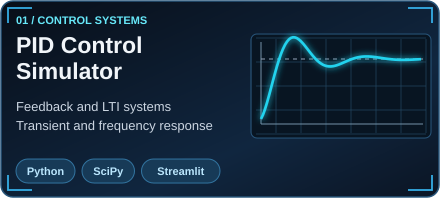
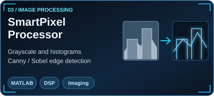
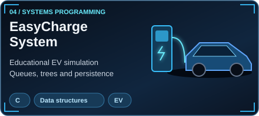
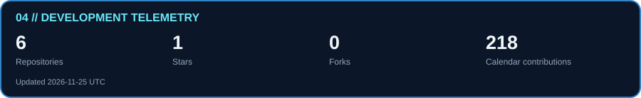
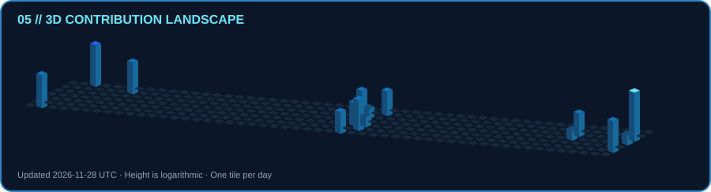

 

 

 

Project details, live demo and validation notes

| Project | Engineering focus |
| --- | --- |
| [SignalLab](https://github.com/DanoV1m/SignalLab) · [Baseline CI](https://github.com/DanoV1m/SignalLab/actions/runs/46008429918) | Independent FFT, STFT, Butterworth, reconstruction, six guided experiments; 45 Node and 24 Chromium checks in baseline CI |
| [PID Control Simulator](https://github.com/DanoV1m/pid-control-simulator) · [Documented live demo](https://idan-pid-simulator.streamlit.app/) | LTI feedback, transient and frequency response |
| [Autonomous Line Follower](https://github.com/DanoV1m/Arduino-Line-Follower-Robot) | Sensor-based navigation; experimental PID not physically retested |
| [SmartPixelProcessor](https://github.com/DanoV1m/SmartPixelProcessor) | Intensity transformations and edge detection |
| [EasyCharge System](https://github.com/DanoV1m/EasyCharge-System) | Educational EV charging simulator, not a production service |

SignalLab research candidate [PR #4](https://github.com/DanoV1m/SignalLab/pull/4): [verified snapshot](https://github.com/DanoV1m/SignalLab/commit/bf5a5ac6268163ad65cafc9471c3b5c5e1bd359e) passed 53 independent NumPy/SciPy cases and 139 numerical comparisons ([CI evidence](https://github.com/DanoV1m/SignalLab/actions/runs/46009785710)). This snapshot is not a released live demo. Card graphics are illustrations, not measured results or screenshots.

About the data and technical toolbox

Language bytes are repository composition, not proficiency. Public, owned, non-fork repositories only. Calendar graphics use GitHub's contribution aggregate, not private repository names or code. They may reflect aggregate private activity if GitHub exposes it under profile visibility settings.

Embedded and digital systems: Arduino, FPGA coursework, digital logic, circuit analysis. Engineering methods: modeling, simulation, debugging, documentation and testing.

## Academic background

Electrical Engineering, Ruppin Academic Center. Coursework includes circuit theory, digital systems, computer architecture, differential equations, mathematics and physics.

Engineering review branches — proposed upgrades, not releases

- [Control systems review](https://github.com/DanoV1m/pid-control-simulator/tree/upgrade/engineering-review): root locus, Nyquist and actuator saturation experiments.
- [Embedded robotics review](https://github.com/DanoV1m/Arduino-Line-Follower-Robot/tree/upgrade/engineering-review): optional discrete PID and bench validation protocol.
- [Image processing review](https://github.com/DanoV1m/SmartPixelProcessor/tree/upgrade/engineering-review): spatial filtering, FFT and image similarity metrics.
- [C systems review](https://github.com/DanoV1m/EasyCharge-System/tree/upgrade/engineering-review): ownership fixes, staged persistence and cross-platform checks.

<strong>DESIGN · BUILD · SIMULATE · VALIDATE</strong>

